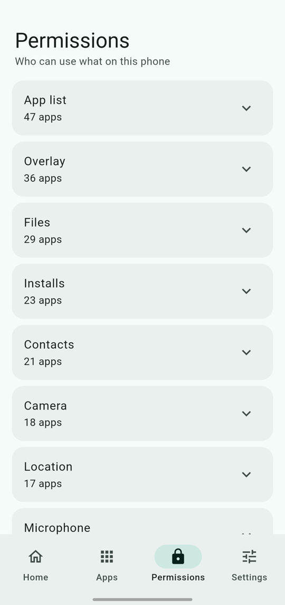

<div align="center">


# Peekless

**See who's peeking at you.**

An offline privacy auditor for Android. Peekless checks the permissions and trackers of every app on your phone, gives each app a privacy score, and tells you in plain English what it can do.

No account. No ads. No analytics. Nothing leaves your phone.

[Download](https://github.com/lumio-apps/peekless/releases/latest) · [Report a problem](https://github.com/lumio-apps/peekless/issues) · [Lumio Apps](https://lumio-apps.online)

</div>

<p align="center">
  
  &nbsp;
  
  &nbsp;
  
</p>

## What it does

- **Privacy score for the whole phone** from 0 to 100, with the number of Risky, Medium and Safe apps.
- **Score for every app**, sorted with the riskiest first. Search and filter included.
- **Permissions view.** See which apps can use your microphone, camera, location, contacts, SMS, call log and more.
- **Tracker detection.** Finds known ad and analytics SDKs (Google Ads, Firebase Analytics, Facebook SDK, AppsFlyer and about 45 others).
- **Plain-language explanations**, for example "Can record audio and track your location all the time."
- **Unusual permissions.** A flashlight or calculator that wants your microphone loses extra points.
- **Score explained.** Every score comes with a full breakdown, so you can see exactly why.
- **Security checks.** Finds apps with accessibility access, device admin or notification access, apps installed from outside a store, debuggable builds and apps built for very old Android.
- **Install source.** Every app shows where it came from: Google Play, another store, an APK file or a computer.
- **Offline apps.** Apps without the internet permission are marked Offline, because they cannot send data online.
- **Trackers view.** Switch the Permissions tab to Trackers to see which tracker sits in which apps.
- **Score over time.** A small chart on Home shows how your phone score changes day by day.
- **Unused apps (optional).** If you turn on Usage access, Peekless finds apps you have not opened for 60 days that can still use sensitive permissions.
- **Fix wizard.** Walks you through the apps with sensitive access one by one: open the app's settings, trust it, or skip it.
- **Filters.** On the Apps tab: Risky, Medium, Safe, Has trackers, Special access, Not from a store, Offline and Trusted.
- **Weekly summary (optional).** One notification a week with your score, how it moved and what changed.
- **Changes.** A list of new apps, removed apps, newly allowed permissions and new trackers.
- **App alerts (optional).** A notification when a new app is installed or an app gets a sensitive permission. The check runs on your phone about every 6 hours.
- **Trusted apps.** Mark an app you trust and it leaves the Risky count and the alerts.
- **One tap to fix.** "Open app settings" takes you straight to the app's Android settings to remove a permission.
- **Share a report** as plain text.
- **Light and dark theme**, Material 3.
- **Updates from inside the app.** Download and install a new version without leaving Peekless.

## How the score works

Every app starts at 100. Points are removed for what the app is able to do:

| What | Points removed |
| --- | --- |
| A sensitive permission that is allowed | Its weight (for example microphone 12, camera 8, read SMS 14, location all the time 22) |
| A special permission that is only requested (all files, draw over apps, install apps) | Half of its weight |
| Each known tracker | 6, up to 30 in total |
| Special access that is turned on | Accessibility 20, device admin 15, notification access 10 |
| A debuggable build | 8 |
| An app built for Android 7 or older (API level below 26) | 4 |
| A permission that is unusual for the kind of app (tool, game, media app) | 20 each, for up to 2 permission groups |

Only the heaviest permission in each group counts, so precise and approximate location are not counted twice.

**70 or more is Safe. 40 to 69 is Medium. Below 40 is Risky.** The phone score is the average of all apps you have not marked as trusted.

The full breakdown for each app is inside Peekless, under **How is this score calculated?**

## Privacy

Peekless is built to protect your privacy, so it holds itself to the same rules.

- It works fully offline. Everything is read from Android on your phone and stays there.
- No ads, no analytics, no crash reporting, no accounts, no servers.
- Your history, trusted apps and settings are stored only on your phone.
- The only network use is the update check, and it happens **only when you tap "Check for updates"**. It contacts GitHub, nothing else.

### Permissions Peekless asks for

| Permission | Why |
| --- | --- |
| `QUERY_ALL_PACKAGES` | To list and check every installed app. |
| `INTERNET` | Only for the update check and download, when you tap it. |
| `REQUEST_INSTALL_PACKAGES` | To open the installer for an update you downloaded. |
| `POST_NOTIFICATIONS` | For App alerts and the Weekly summary, if you turn them on. |
| `RECEIVE_BOOT_COMPLETED` | So App alerts and the Weekly summary keep running after the phone restarts. |
| `PACKAGE_USAGE_STATS` | Optional. Only if you turn on Usage access, to see when an app was last opened. You can switch it off any time in Android settings. |

## What Peekless can and cannot tell you

Please read this part. Peekless is honest about its limits.

- It shows what an app **is able to do**, not what it is doing right now. Android does not let one app see what another app really does with its permissions.
- Trackers are found from the app's manifest, using a list of known SDKs. Some trackers will be missed, especially in heavily obfuscated apps.
- A low score does not prove an app is bad, and a high score does not prove it is safe. It is a guide, not a verdict.
- System apps such as Google Play services legitimately need many permissions. They are hidden by default. You can include them in Settings.

## Install

1. Open the [latest release](https://github.com/lumio-apps/peekless/releases/latest) and download `peekless-x.y.z.apk`.
2. Open the file. If Android asks, allow your browser or file manager to install apps.
3. After that, update from inside Peekless: **Settings → Check for updates**.

Peekless is distributed on GitHub only.

## Build from source

You need [Flutter](https://docs.flutter.dev/get-started/install) (stable) and an Android device or emulator.

```bash
git clone https://github.com/lumio-apps/peekless.git
cd peekless
flutter pub get
dart run flutter_launcher_icons
flutter analyze
flutter test
flutter run
```

To build an APK:

```bash
flutter build apk --release
```

Without a signing key, the release build is signed with the debug key. That is fine for testing, but it cannot update a Peekless installed from a GitHub release.

## Releasing

Releases are built by GitHub Actions (`.github/workflows/release.yml`).

- Every push to `main` builds a signed APK and keeps it as a build artifact.
- Pushing a tag that starts with `v` (for example `v1.3.0`) also publishes the APK as a GitHub Release.
- The APK is signed with a key stored in the repository secrets: `KEYSTORE_BASE64`, `KEYSTORE_PASSWORD`, `KEY_ALIAS` and `KEY_PASSWORD`.

```bash
git tag v1.3.0
git push origin v1.3.0
```

Because every release is signed with the same key, an update installs over the old version and keeps your data.

## Project structure

```text
lib/
  main.dart            App start and the background entry point
  controller.dart      App state: scan results, settings, trusted apps
  scoring.dart         Permission rules, tracker points and the score
  tracker_db.dart      Known tracker SDKs
  history.dart         Snapshot and change detection
  checks.dart          The security checks
  fix_wizard.dart      Which apps the Fix wizard shows and why
  app_filter.dart      Filters on the Apps tab
  weekly.dart          Text of the Weekly summary
  install_source.dart  Store names and sideload detection
  score_history.dart   Daily score for the trend chart
  background.dart      The background check for App alerts
  native_bridge.dart   Calls to the Android side
  updater.dart         In-app update from GitHub Releases
  screens/             Home, Apps, Permissions, Changes, Settings, details
  widgets/             Score ring, app tile, risk chip, security card, trend chart, update dialog
android/app/src/main/kotlin/com/lumioapps/peekless/
  Scanner.kt           Reads installed apps, permissions, trackers, install source and special access
  UsageAccess.kt       Optional: when each app was last opened
  AlertJobService.kt   Runs the background check
  Notifier.kt          Shows notifications
test/                  Tests for scoring, checks, filters, wizard, weekly summary, changes, report and updater
```

## Contributing

Ideas, bug reports and pull requests are welcome. To add a tracker, add its name and class prefix to `lib/tracker_db.dart`. To change how a permission is scored, edit its rule in `lib/scoring.dart`. Please run `flutter analyze` and `flutter test` before you open a pull request.

## About

Peekless is part of [Lumio Apps](https://lumio-apps.online): privacy-focused apps with no ads, no tracking and no data collection.
