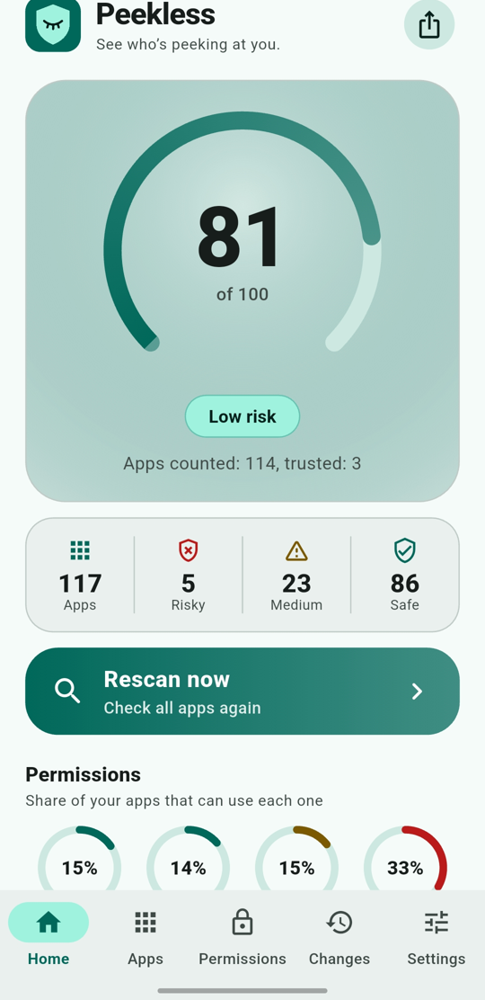
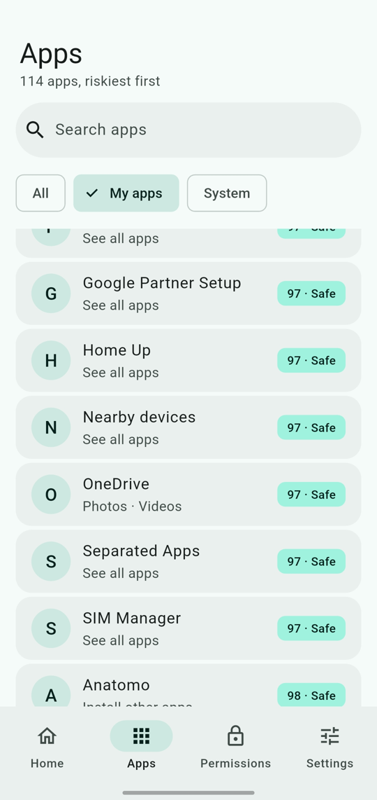
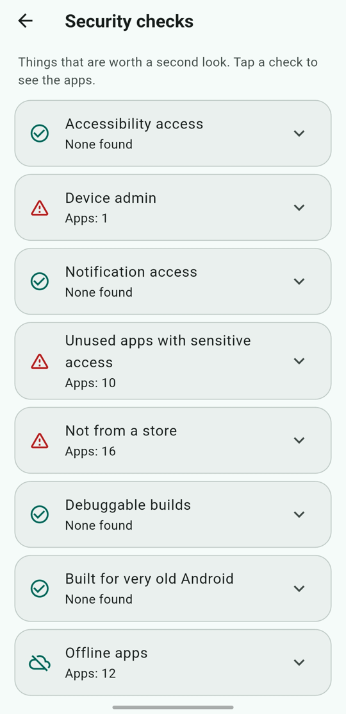
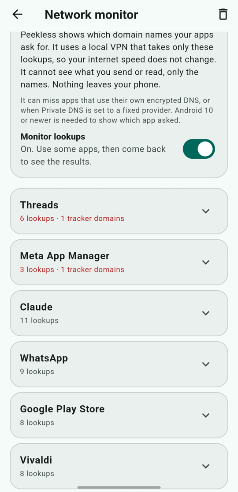

<div align="center">


# Peekless

**See who's peeking at you.**

An offline privacy auditor for Android. Peekless checks the permissions and trackers of every app on your phone, gives each app a privacy score, and tells you in plain English what it can do.

No account. No ads. No analytics. Nothing leaves your phone.

[Download](https://github.com/lumio-apps/peekless/releases/latest) · [Report a problem](https://github.com/lumio-apps/peekless/issues) · [Lumio Apps](https://lumio-apps.online)

</div>

<p align="center">
  
  &nbsp;
  
  &nbsp;
  
  &nbsp;
  
</p>

## At a glance

| | |
| --- | --- |
| **Score** | 0 to 100 for your phone and for every app, with a full breakdown. |
| **Looks at** | Permissions, special access, trackers, install source, and (optional) code and DNS lookups. |
| **Works** | Fully offline. No account, no ads, no analytics, no servers. |
| **Tabs** | Home, Apps, Permissions, Trackers, Settings. Changes opens from the clock icon on Home. |
| **Platform** | Android. 25 languages. Free software (GPL-3.0). |

## What it does

- **Privacy score for the whole phone** from 0 to 100, with the number of Risky, Medium and Safe apps.
- **Score for every app**, sorted with the riskiest first. Search and filter included.
- **Permissions view.** See which apps can use your microphone, camera, location, contacts, SMS, call log and more.
- **Tracker detection.** Finds known ad and analytics SDKs (Google Ads, Firebase Analytics, Facebook SDK, AppsFlyer and about 60 others).
- **Deep scan (optional).** Turn it on in Settings to also read the class names inside each app's code and find trackers that the manifest does not show. It works offline, skips apps that came with your phone, and is slower only the first time because results are remembered.
- **Network monitor (optional).** Shows which domain names each app asks for, and marks the ones that belong to known ad and analytics services. It uses a local VPN that takes **only DNS lookups** (one made-up DNS address is the only route), so your internet speed does not change. It also handles DNS over TCP, which apps use when an answer is too big for one packet. It sees names, never pages, messages or any content, and nothing leaves your phone.
- **Plain-language explanations**, for example "Can record audio and track your location all the time."
- **Unusual permissions.** A flashlight or calculator that wants your microphone loses extra points.
- **Score explained.** Every score comes with a full breakdown, so you can see exactly why.
- **Security checks.** Finds apps with accessibility access, device admin or notification access, apps installed from outside a store, debuggable builds and apps built for very old Android.
- **Install source.** Every app shows where it came from: Google Play, another store, an APK file or a computer.
- **Offline apps.** Apps without the internet permission are marked Offline, because they cannot send data online.
- **Trackers tab.** Its own tab: see which tracker sits in which apps, most common first.
- **Score over time.** A small chart on Home shows how your phone score changes day by day.
- **Unused apps (optional).** If you turn on Usage access, Peekless finds apps you have not opened for 60 days that can still use sensitive permissions.
- **Fix wizard.** Walks you through the apps with sensitive access one by one: open the app's settings, trust it, or skip it.
- **Filters.** On the Apps tab: Risky, Medium, Safe, Has trackers, Special access, Not from a store, Offline and Trusted.
- **Weekly summary (optional).** One notification a week with your score, how it moved and what changed.
- **Changes.** Open it with the clock icon at the top of Home. A list of new apps, removed apps, newly allowed permissions and new trackers.
- **App alerts (optional).** A notification when a new app is installed or an app gets a sensitive permission. The check runs on your phone about every 6 hours.
- **Trusted apps.** Mark an app you trust and it leaves the Risky count and the alerts.
- **One tap to fix.** "Open app settings" takes you straight to the app's Android settings to remove a permission.
- **Share a report** as plain text.
- **Export as PDF or JSON.** Save the full report as a PDF to read or print, or as a JSON file to keep or process. The PDF is drawn on your phone with its own fonts, so every language looks right.
- **Home screen widget.** Your privacy score at a glance, colored by risk. Tap it to open Peekless.
- **Quick Settings tile.** See your score in the quick settings panel (Android 7 or newer).
- **Tracker list updates.** Tap "Tracker list" in Settings to get newly known trackers without waiting for an app update.
- **25 languages.** English, Hindi, Armenian, Russian, Spanish, French, German, Italian, Portuguese, Turkish, Arabic, Persian, Hebrew, Urdu, Chinese (Simplified and Traditional), Japanese, Korean, Indonesian, Vietnamese, Thai, Polish, Ukrainian, Dutch and Bengali. Peekless follows your phone language, or you can pick one in Settings.
- **New look.** A dark green design with a gauge for your score, a Privacy overview (what share of your apps can use camera, microphone, location and trackers) and one big Scan button. Light and dark themes, Material 3.
- **Updates from inside the app.** Download and install a new version without leaving Peekless.

## How the score works

Every app starts at 100. Points are removed for what the app is able to do:

| What | Points removed |
| --- | --- |
| A sensitive permission that is allowed | Its weight (for example microphone 12, camera 8, read SMS 14, location all the time 22) |
| A special permission that is only requested (all files, draw over apps, install apps) | Half of its weight |
| Each known tracker | 6, up to 30 in total |
| Special access that is turned on | Accessibility 20, device admin 15, notification access 10 |
| A debuggable build | 8 |
| An app built for Android 7 or older (API level below 26) | 4 |
| A permission that is unusual for the kind of app (tool, game, media app) | 20 each, for up to 2 permission groups |

Only the heaviest permission in each group counts, so precise and approximate location are not counted twice.

**70 or more is Safe. 40 to 69 is Medium. Below 40 is Risky.** The phone score is the average of all apps you have not marked as trusted.

The full breakdown for each app is inside Peekless, under **How is this score calculated?**

## Privacy

Peekless is built to protect your privacy, so it holds itself to the same rules.

- It works fully offline. Everything is read from Android on your phone and stays there.
- No ads, no analytics, no crash reporting, no accounts, no servers.
- Your history, trusted apps and settings are stored only on your phone.
- The Deep scan only reads class names from the APK files on your phone. It never reads app data, and nothing is sent anywhere.
- The Network monitor is off until you switch it on. Android then asks you to allow a VPN connection. It reads only the domain names that apps look up, keeps counts on your phone, and you can clear them at any time. You can switch it off in Peekless or in Android settings.
- The only network use is the app update check and the tracker list update. Each one happens **only when you tap it** in Settings, and contacts GitHub, nothing else. No information about you or your apps is sent.
- A downloaded tracker list can only add trackers. It is checked before use, and a broken or unsafe file is ignored.
- PDF and JSON reports are created on your phone and shared only when you choose an app to send them to.

### Permissions Peekless asks for

| Permission | Why |
| --- | --- |
| `QUERY_ALL_PACKAGES` | To list and check every installed app. |
| `INTERNET` | Only for the update check, the update download and the tracker list update, when you tap them. |
| `REQUEST_INSTALL_PACKAGES` | To open the installer for an update you downloaded. |
| `POST_NOTIFICATIONS` | For App alerts and the Weekly summary, if you turn them on. |
| `RECEIVE_BOOT_COMPLETED` | So App alerts and the Weekly summary keep running after the phone restarts. |
| `BIND_VPN_SERVICE` (service) | Only for the Network monitor. Android asks you before it starts. |
| `ACCESS_NETWORK_STATE` | Network monitor: to find your phone's own DNS server, so lookups are passed on unchanged. |
| `PACKAGE_USAGE_STATS` | Optional. Only if you turn on Usage access, to see when an app was last opened. You can switch it off any time in Android settings. |

## What Peekless can and cannot tell you

Please read this part. Peekless is honest about its limits.

- It shows what an app **is able to do**, not what it is doing right now. Android does not let one app see what another app really does with its permissions.
- Trackers are found from the app's manifest, using a list of known SDKs. With the optional Deep scan they are also searched for in the app's code. Some trackers will still be missed, especially in heavily obfuscated apps, because their class names are scrambled.
- The Network monitor sees DNS lookups only. It can miss apps that use their own encrypted DNS (DNS over HTTPS), and it does not work when Android's Private DNS is set to a fixed provider. To show which app asked, it needs Android 10 or newer. A domain that matches a tracker list shows that the app contacted that service, not what it sent.
- A low score does not prove an app is bad, and a high score does not prove it is safe. It is a guide, not a verdict.
- System apps such as Google Play services legitimately need many permissions. They are hidden by default. You can include them in Settings.

## Install

1. Open the [latest release](https://github.com/lumio-apps/peekless/releases/latest) and download `peekless-x.y.z.apk`.
2. Open the file. If Android asks, allow your browser or file manager to install apps.
3. After that, update from inside Peekless: **Settings → Check for updates**.

Peekless is also prepared for [F-Droid](https://f-droid.org). F-Droid builds the app from source and signs it with its own key, so an F-Droid install and a GitHub install cannot update each other. Pick one source and stay with it.

## Build from source

You need [Flutter](https://docs.flutter.dev/get-started/install) (stable) and an Android device or emulator.

```bash
git clone https://github.com/lumio-apps/peekless.git
cd peekless
flutter pub get
dart run flutter_launcher_icons
flutter analyze
flutter test
flutter run
```

To build an APK:

```bash
flutter build apk --release
```

Without a signing key, the release build is signed with the debug key. That is fine for testing, but it cannot update a Peekless installed from a GitHub release.

## F-Droid build

F-Droid updates apps itself, so its build must not contain the in-app updater:

```bash
flutter build apk --release --dart-define=FDROID=true
```

This hides "Check for updates" in Settings. The `REQUEST_INSTALL_PACKAGES` permission is removed from the manifest in the F-Droid recipe (`docs/fdroid/com.lumioapps.peekless.yml`). Store texts, icon and screenshots are in `fastlane/metadata/android/en-US/`. Each release needs a changelog named after its version code, for example `changelogs/12.txt`.

## Releasing

Releases are built by GitHub Actions (`.github/workflows/release.yml`).

- Every push to `main` builds a signed APK and keeps it as a build artifact.
- Pushing a tag that starts with `v` (for example `v2.2.1`) also publishes the APK as a GitHub Release.
- The APK is signed with a key stored in the repository secrets: `KEYSTORE_BASE64`, `KEYSTORE_PASSWORD`, `KEY_ALIAS` and `KEY_PASSWORD`.

```bash
git tag v2.2.1
git push origin v2.2.1
```

Because every release is signed with the same key, an update installs over the old version and keeps your data.

## Project structure

```text
lib/
  main.dart            App start and the background entry point
  controller.dart      App state: scan results, settings, trusted apps
  scoring.dart         Permission rules, tracker points and the score
  tracker_db.dart      Built-in tracker SDKs
  access_share.dart    How many apps can use camera, microphone, location and trackers
  tracker_domains.dart Domain names of known ad and analytics services
  net_report.dart      Reads the network monitor report
  tracker_store.dart   Downloaded tracker list: checks it and adds it to the built-in one
  export.dart          Builds the PDF and JSON report
  history.dart         Snapshot and change detection
  security_checks.dart The security checks
  fix_queue.dart       Which apps the Fix wizard shows and why
  app_filter.dart      Filters on the Apps tab
  weekly.dart          Text of the Weekly summary
  texts.dart           Turns data into translated text
  l10n/                Translations (.arb files)
  language_names.dart  Language names for the picker
  install_source.dart  Store names and sideload detection
  score_history.dart   Daily score for the trend chart
  background.dart      The background check for App alerts
  native_bridge.dart   Calls to the Android side
  updater.dart         In-app update from GitHub Releases
  build_flavor.dart    F-Droid switch (hides the updater)
  screens/             Home, Apps, Permissions, Trackers, Changes, Settings, details
  widgets/             Score ring, app tile, risk chip, security card, trend chart, update dialog
android/app/src/main/kotlin/com/lumioapps/peekless/
  Scanner.kt           Reads installed apps, permissions, trackers, install source and special access
  NetMonitorService.kt Network monitor: the DNS-only local VPN
  DnsTcp.kt            Network monitor: DNS over TCP for big answers
  NetStats.kt          Keeps the domain counts for each app
  DexScanner.kt        Deep scan: reads class names from the app's .dex files
  UsageAccess.kt       Optional: when each app was last opened
  AlertJobService.kt   Runs the background check
  Notifier.kt          Shows notifications
  Glance.kt            Keeps the newest score for the widget and the tile
  ScoreWidget.kt       Home screen widget
  ScoreTileService.kt  Quick Settings tile
  PdfExport.kt         Draws the PDF report
  ExportFileProvider.kt Shares exported files safely
data/
  trackers.json        The tracker list that the app downloads when you tap "Tracker list"
test/                  Tests for scoring, checks, filters, wizard, weekly summary, changes, report and updater
```

## Languages

All texts are in `lib/l10n/app_<code>.arb` files. `app_en.arb` is the template. To fix a translation, edit the line in the language file and open a pull request. To add a language, copy `app_en.arb` to `app_<code>.arb`, translate the values (keep the `{placeholders}` as they are), and add the language to `lib/language_names.dart`. Then run `flutter gen-l10n`.

## Contributing

Ideas, bug reports and pull requests are welcome. To add a tracker, add its name and class prefix to `lib/tracker_db.dart` (built in) and to `data/trackers.json` (raise its `version` by one, and every app can get it with one tap). To change how a permission is scored, edit its rule in `lib/scoring.dart`. Please run `flutter analyze` and `flutter test` before you open a pull request.

## License

Peekless is free software under the **GNU General Public License v3.0** (GPL-3.0). See [LICENSE](LICENSE). Copyright (C) 2026 Lumio Apps. The name "Peekless" and its logo are not covered by the license.

## About

Peekless is part of [Lumio Apps](https://lumio-apps.online): privacy-focused apps with no ads, no tracking and no data collection.
